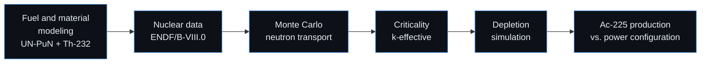
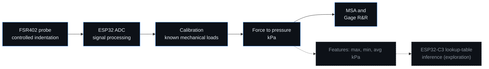
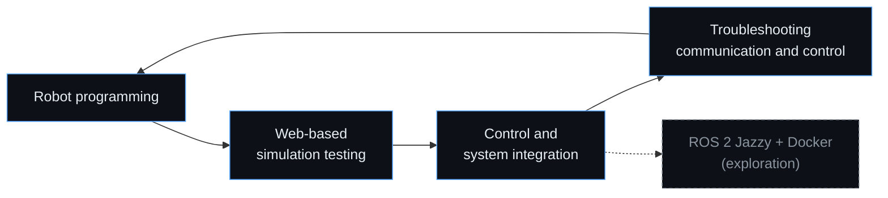

<div align="center">


<a href="https://github.com/bfox8623">
  
</a>

<br/>


<br/>

[](#about)
[](#featured-projects)
[](#technical-skills)
[](#contact)

</div>

---

<table align="center">
  <tr>
    <td align="center"><b>AISEEF 2026</b><br/><sub>Gold Medalist<br/>Physics, Energy & Engineering</sub></td>
    <td align="center"><b>Nuclear Physics Club</b><br/><sub>Chairman<br/>University of Jember</sub></td>
    <td align="center"><b>Kibo-RPC 7th</b><br/><sub>Team Leader of Jatra<br/>JAXA programming challenge</sub></td>
    <td align="center"><b>REIVER Team</b><br/><sub>Team Leader<br/>Robotics R&D, UNEJ</sub></td>
  </tr>
</table>

---

## About

I am a Physics student at the University of Jember. I use fundamental physics as the starting point for computational research and for building hardware that measures, senses, and moves.

My academic interests are **nuclear physics, reactor physics, computational physics, and materials physics**. On the technical side I work on **robotics, embedded systems, instrumentation, and applied machine learning**. My research direction sits where the two meet: reactor modeling, radioisotope production, and simulation-driven analysis on one side, and hardware prototyping on the other.

```text
$ whoami
bfox8623 :: physics student
$ focus --list
  nuclear reactor modeling · scientific computing · instrumentation · robotics · embedded ML
```

## Research & Technical Interests

| Area | What I work on |
|---|---|
| **Nuclear & Reactor Physics** | Monte Carlo neutron transport, criticality (k-eff) analysis, depletion and isotope production, radioisotopes for targeted alpha therapy |
| **Computational Physics** | Simulation workflows, parallel computing environments, FEA, scientific visualization |
| **Instrumentation** | Force/pressure measurement, sensor calibration, measurement system analysis (MSA, Gage R&R) |
| **Robotics & Embedded Systems** | ESP32 control, autonomous robot programming, power electronics for robots |
| **Machine Learning (exploratory)** | Sensor data classification, deployment on resource-constrained microcontrollers |

---

## Featured Projects

### Th-232-Doped UN–PuN Gas-Cooled Fast Reactor for Ac-225 Production
`OpenMC 0.15.3` · `ENDF/B-VIII.0` · `Python` · **AISEEF 2026 Gold Medalist**

A **computational** study of a thorium-doped uranium–plutonium nitride (UN–PuN) gas-cooled fast reactor, investigating its potential for producing Actinium-225 for targeted alpha therapy.



- Reactor material and fuel composition modeling
- Monte Carlo neutron transport and k-effective criticality analysis
- Depletion simulation and isotope production analysis
- Effect of power configuration on Ac-225 production

**My contribution:** reactor modeling and neutronic simulations.

> [!IMPORTANT]
> Simulation-based research only. No physical reactor was built or operated.

---

### Abdominal Tonometer with Embedded ML Exploration
`ESP32 / ESP32-C3` · `FSR402` · `ADC` · `Python` · `C/C++`

An instrumentation physics project: a pressure measurement approach based on controlled indentation depth, for studying abdominal muscle guarding (*defans muskular*).



- FSR402-based probe, ADC signal processing, calibration with known mechanical loads
- Force-to-pressure conversion in kPa, probe design, and measurement methodology
- Ongoing: dataset preprocessing, feature engineering, and lookup-table-based classification inference on the ESP32-C3 Super Mini

> [!NOTE]
> A research and measurement prototype. Not a validated clinical or diagnostic device. Dashed boxes are ongoing exploration.

---

### Kibo-RPC: Autonomous Robot Programming and System Integration
`JAXA Kibo-RPC` · `Python` · `Docker` · `ROS 2 (exploration)`

Team Leader in the JAXA Kibo Robot Programming Challenge.



ROS 2 Jazzy simulation in Docker was explored for future development and is not a completed integration.

<div align="center">

<a href="https://github.com/bfox8623/kibo">
  
</a>

</div>

---

<details>
<summary><b>Additional exploration</b> (expand)</summary>

<br/>

- **AI and physics-informed learning (exploratory):** studying AI-driven rocket engine geometry generation (PicoGK, CFD, regenerative cooling) and a latent physics-informed neural network in PyTorch for hidden-state discovery in circuit simulation.
- **Reverse engineering and CTF practice:** binary exploitation and cryptography challenges with GDB and GEF.
- **Open-source IC design workflow:** exploring Yosys and Verilog.

</details>

---

## Technical Skills

<div align="center">


</div>

<br/>

Levels reflect depth of project experience, not formal certification.

| Domain | Working With | Familiar With / Project Experience |
|---|---|---|
| **Computational Physics** | OpenMC, Python | Neutron transport, depletion analysis, reactor modeling, ANSYS FEA |
| **Programming** | Python, C/C++ for embedded targets | C (structured self-study) |
| **Embedded Systems** | ESP32, ESP32-C3, Arduino framework | UART, I2C, ADC, OLED interfaces, PCB power design |
| **Robotics** | Robot programming and control | Kibo-RPC, hardware integration, system troubleshooting |
| **Machine Learning** | Dataset preprocessing, feature engineering | Model training, embedded ML deployment (exploratory) |
| **Scientific Computing & Tools** | Git/GitHub, Arch Linux | Docker, OpenMPI, OpenMP, NFS, SSH, tmux |

---

## Currently Exploring

| Track | Focus |
|---|---|
| **Embedded ML** | Sensor classification inference on ESP32-C3 |
| **Robotics software** | ROS 2 Jazzy simulation environments with Docker |
| **HPC for nuclear sim** | Hybrid MPI/OpenMP parallelization for OpenMC workloads |
| **Low-level computing** | C programming (`kernel-journey/c-journey`) |
| **Hardware design** | Open-source IC design tooling (Yosys, Verilog) |

---

## GitHub Statistics

<div align="center">


</div>

---

## Contact

<div align="center">

[](mailto:alrizyad@gmail.com)
[](https://linkedin.com/in/your-handle)
[](https://instagram.com/your-handle)

<br/>

<sub>Exploring the intersection of fundamental science, computational research, and real-world technological development.</sub>


</div>
